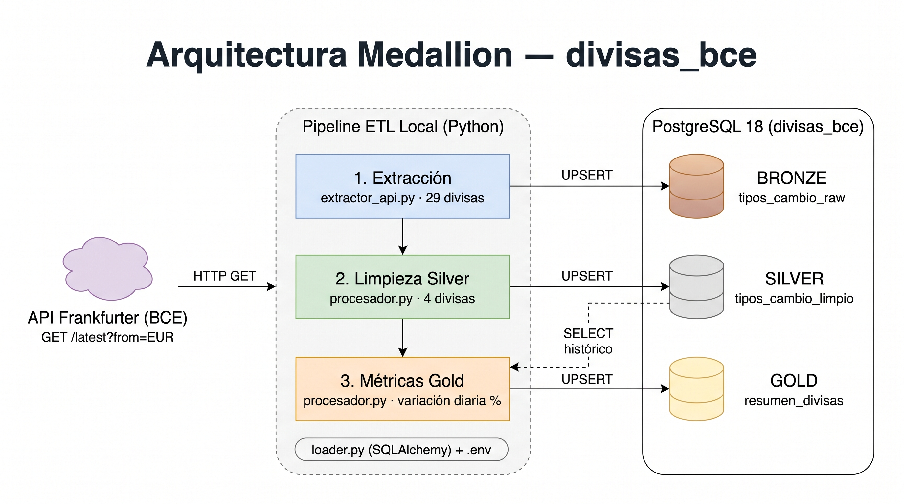

# 💶 divisas_bce — Pipeline ETL Medallion de Divisas del BCE

**Un pipeline de Ingeniería de Datos idempotente basado en Arquitectura Medallion (Bronze, Silver, Gold) que extrae tipos de cambio oficiales del Banco Central Europeo y los persiste en PostgreSQL, diseñado como laboratorio local previo a su migración a Azure Databricks (DP-750).**



---

## 🛑 El problema
Consultar tipos de cambio manualmente o sobrescribir una única tabla plana cada día impide construir un histórico fiable para análisis financiero. Además, el Banco Central Europeo no publica cotizaciones los fines de semana ni festivos: un script ingenuo que inserta datos sin control acaba duplicando cierres del viernes, rompiendo la integridad histórica y mezclando datos crudos con métricas de negocio. Necesitábamos una arquitectura desacoplada, 100% idempotente y preparada para escalar a un entorno Lakehouse en la nube sin reescribir la lógica de negocio.

## ✨ Qué hace
1. **Capa Bronze (Ingesta Cruda):** Conecta a la API de Frankfurter (datos oficiales del BCE), descarga las 29 divisas disponibles sin filtros ni redondeos y las almacena en `bronze.tipos_cambio_raw` con marca de tiempo de ingesta (`fecha_ingesta`).
2. **Capa Silver (Limpieza y Curado):** Filtra las divisas estratégicas (`USD`, `GBP`, `JPY`, `CHF`), aplica tipado estricto (`NUMERIC`, `DATE`) y redondeo a 2 decimales antes de cargarlas en `silver.tipos_cambio_limpio`.
3. **Capa Gold (Métricas de Negocio):** Lee el histórico consolidado de Silver y calcula la **variación diaria porcentual (`variacion_diaria_pct`)** por divisa mediante operaciones vectorizadas en Pandas, dejando `gold.resumen_divisas` lista para consumo analítico o APIs REST.
4. **Idempotencia Atómica (UPSERT):** Utiliza claves primarias compuestas `(fecha_actualizacion, moneda_destino)` junto a `INSERT ... ON CONFLICT DO UPDATE` en las tres capas, replicando el comportamiento de `MERGE INTO` en Delta Lake.

## 🏗️ Cómo lo construí
El proyecto sigue una arquitectura Medallion modular en local diseñada para mapear 1 a 1 con **Azure Databricks**:
- **Orquestación (`main.py`):** Ejecución secuencial de las 3 capas (simulando un *Databricks Workflow* de tareas encadenadas).
- **Extracción (`extractor_api.py`):** Python con `requests` y `pandas` consumiendo `api.frankfurter.app`.
- **Transformación (`procesador.py`):** Operaciones vectorizadas de Pandas (`groupby`, `pct_change`, filtrado) pensadas para traducirse directamente a **PySpark DataFrames**.
- **Carga (`loader.py`):** **SQLAlchemy** + `psycopg2` ejecutando sentencias `UPSERT` parametrizadas y conversión explícita de `NaN` a `NULL`.
- **Base de Datos:** **PostgreSQL 18** (Homebrew en macOS) organizado en tres esquemas independientes (`bronze`, `silver`, `gold`) con DDL explícito y gestión de credenciales vía `.env`.

## 🚀 Cómo probarlo

### 1. Variables de Entorno (`.env`)
Crea un archivo `.env` en la raíz del proyecto:
```env
DB_USER=sergio_app
DB_PASSWORD=TuContraseñaSegura
DB_HOST=localhost
DB_PORT=5432
DB_NAME=divisas_bce
```

### 2. Inicializar Esquemas y Tablas en PostgreSQL
Conéctate a tu base de datos (`psql -d divisas_bce -U sergio_app`) y crea la estructura Medallion:
```sql
CREATE SCHEMA IF NOT EXISTS bronze AUTHORIZATION sergio_app;
CREATE SCHEMA IF NOT EXISTS silver AUTHORIZATION sergio_app;
CREATE SCHEMA IF NOT EXISTS gold AUTHORIZATION sergio_app;

CREATE TABLE IF NOT EXISTS bronze.tipos_cambio_raw (
    fecha_actualizacion DATE NOT NULL,
    moneda_base VARCHAR(3) NOT NULL,
    moneda_destino VARCHAR(3) NOT NULL,
    tasa_cambio NUMERIC(12, 6) NOT NULL,
    fecha_ingesta TIMESTAMP DEFAULT CURRENT_TIMESTAMP,
    PRIMARY KEY (fecha_actualizacion, moneda_destino)
);

CREATE TABLE IF NOT EXISTS silver.tipos_cambio_limpio (
    fecha_actualizacion DATE NOT NULL,
    moneda_base VARCHAR(3) NOT NULL,
    moneda_destino VARCHAR(3) NOT NULL,
    tasa_cambio NUMERIC(10, 2) NOT NULL,
    PRIMARY KEY (fecha_actualizacion, moneda_destino)
);

CREATE TABLE IF NOT EXISTS gold.resumen_divisas (
    fecha_actualizacion DATE NOT NULL,
    moneda_base VARCHAR(3) NOT NULL,
    moneda_destino VARCHAR(3) NOT NULL,
    tasa_cambio NUMERIC(10, 2) NOT NULL,
    variacion_diaria_pct NUMERIC(6, 2),
    PRIMARY KEY (fecha_actualizacion, moneda_destino)
);
```

### 3. Instalación y Ejecución
```bash
# Crear entorno virtual e instalar dependencias
python3 -m venv venv
source venv/bin/activate
pip install requests pandas sqlalchemy psycopg2-binary python-dotenv

# Ejecutar el pipeline completo (Bronze -> Silver -> Gold)
python main.py
```

## 🧠 Aprendizajes
- **Idempotencia real en Base de Datos (`UPSERT` vs `SELECT COUNT`):** Pasar de comprobaciones manuales en Python a claves primarias compuestas con `ON CONFLICT DO UPDATE` blinda los datos ante ejecuciones repetidas o fines de semana sin publicación del BCE, aplicando la misma lógica que `MERGE INTO` en Delta Lake.
- **La trampa de `NaN` vs `NULL` entre Pandas y PostgreSQL:** Al calcular variaciones diarias en el primer registro histórico, Pandas genera `NaN` y PostgreSQL lo acepta en columnas `NUMERIC`. Interceptarlo y convertirlo a `None` (`NULL`) evita futuros errores de serialización JSON al exponer la capa Gold en FastAPI.
- **Separación de responsabilidades (Medallion):** Conservar las 29 divisas crudas en Bronze permite añadir nuevas monedas o recalcular métricas en Silver y Gold en el futuro sin depender de volver a consultar la API externa.
- **Preparación DP-750:** Estructurar esquemas independientes, definir DDL explícito y diseñar transformaciones vectorizadas en local sienta las bases exactas para migrar el flujo a **Unity Catalog**, **PySpark** y **Lakeflow / Delta Live Tables** en Azure Databricks.

## 🗺️ Próximos pasos (Roadmap)
- [x] **v1.0.0 (MVP):** Script ETL básico con carga incremental en tabla única (`public.tipos_cambio_bce`).
- [x] **v2.0.0 (Medallion):** Refactorización a arquitectura de 3 capas (`bronze`, `silver`, `gold`), DDL estricto, `UPSERT` atómico y cálculo de variación diaria.
- [ ] **v3.0.0 (Backfill & API):** Carga histórica de rangos de fechas desde Frankfurter, catálogo de nombres de divisas y microservicio **FastAPI** leyendo exclusivamente de `gold.resumen_divisas`.
- [ ] **v4.0.0 (Cloud Lakehouse - DP-750):** Migración a **Azure Databricks** (ADLS Gen2 / Unity Catalog Volumes, PySpark, Delta Tables con `MERGE INTO` y Databricks Workflows).